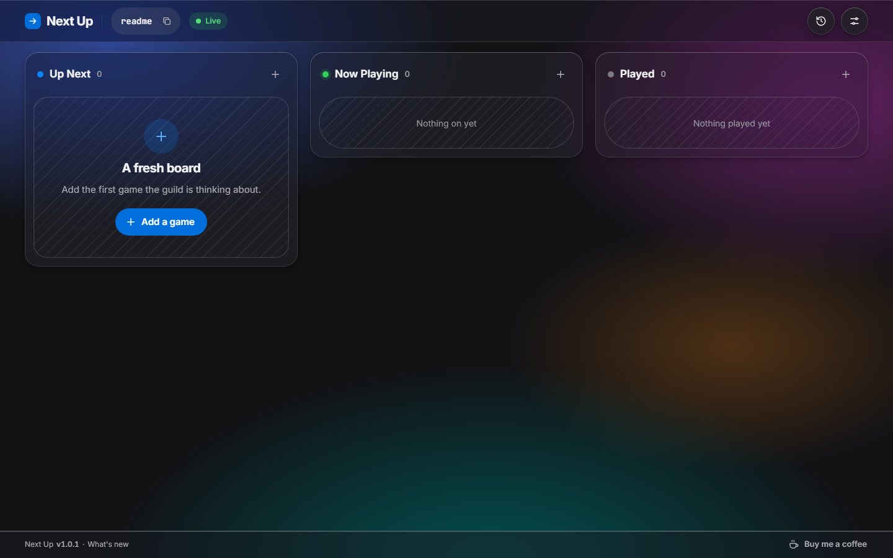

# Next Up

A no-accounts kanban for planning which game a group plays next: type a code, get a shared board.

**Live:** https://nextup.postnerfclarity.com

Built by Jamie Cahn · https://jamiecahn.com



## What it does

- **Open or create a board with a code.** One box on the front page: type a code and you're on that board, or offered to create it. No sign-up, no login, no email.
- **Three lanes: Up Next, Now Playing, Played.** Each game is a wide card with its art (31 games so far). Drag cards between and within lanes with a mouse, by long-press on a phone, or from the keyboard.
- **Card details for game night.** A go-live date, a free-text server info box (web addresses become links), and a sign-up list where anyone can add or remove players.
- **Live updates.** Changes appear for everyone viewing the board as they happen, with a "Live" indicator that only says Live while it's actually connected.
- **Full history with restore.** Every change is logged with who made it. Card edits, deletes, moves and removed sign-ups can be restored, and a restore can itself be undone.
- **Optional password, chosen once at creation.** With one, someone who has only the code sees a lock screen and nothing else, so server info stays private.

## Why I built it

I built Next Up so my WoW guild, Post Nerf Clarity, could plan our next game together. It's a no-accounts kanban: type a code to open or create a board, anyone with the code can edit it, with full history and restore, and a password set at creation means outsiders with only the code see just a lock screen, so server info stays private. The guild tested it on a real rotation, and it works well on phones.

## How it works

**Boards and codes.** A board's code is its key. Codes are 3–32 letters, numbers and hyphens, and capitals don't matter (`PNC-Raids` and `pnc-raids` are the same board). Nothing lists or searches boards: you can only open one whose code you know. Each board has its own address, `/b/<code>`.

**Passwords.** When you create a board you choose, once, whether it has one. A board without a password is open to anyone with the code, for good: a password can't be added later. A board with one shows only a lock screen until the password is entered, and every API answer for it is just "locked". The password can be changed (the current one is required) but never removed, and it can't be recovered. Passwords are stored as argon2id hashes. Once you unlock a board, your browser remembers it with a signed, httpOnly cookie until you press the lock on the code chip. When the password changes, every other browser goes back to the lock screen.

**History and restore.** Every change is written to an append-only log in the same database transaction as the change itself, labelled with the display name the browser chose (or "Someone"). The name is a label, not a verified identity, and History says so. Restoring never rewrites the log: it makes the change and adds a new entry. If the board has moved on since, restore puts back only what that change touched, as close to its old place as the board now allows, and shows you what will change first. Password changes are logged but can't be restored.

**Live sync.** Each open board holds a Server-Sent Events stream. When anyone changes something, everyone else sees it within a moment, with a short highlight saying who did what. If the connection drops, the board says so, shows how old it is, pauses editing until it's back, then catches up on exactly the changes it missed. Two people saving the same card never silently overwrite each other: the second save sees the newer version first.

**Deleting a board.** Anyone who can open a board can delete it from Settings by typing its code. For 24 hours it shows a countdown with a Restore button; after that the board and its whole history are erased and the code is free again.

**The read-only MCP server.** A second process exposes boards to AI assistants such as Claude over the [Model Context Protocol](https://modelcontextprotocol.io) (Streamable HTTP at `POST /mcp`). Its tools are `get_board`, `get_card`, `get_history` and `get_version`. It opens the database read-only, so SQLite itself refuses writes from it, needs a bearer token (`MCP_BEARER_TOKEN`) on every request, only reads a board whose code you give it, and answers only "locked" for password boards. Keep it on your own network: it is not meant to be public.

**Abuse limits.** With no accounts, limits are per network (IPv6 grouped by /64): 30 unknown codes or board creations per 15 minutes, and 10 wrong passwords per 15 minutes across all boards, the lock screen and Settings together. There are also caps of 500 boards, 200 cards per board and 100 players per card. The rate limits live in memory, so a restart resets them.

**Security headers.** Every response carries a Content-Security-Policy that allows only Next Up's own scripts, styles, fonts and images (no inline scripts, no framing), plus `nosniff`, `Referrer-Policy: no-referrer` (a board's address holds its code) and a Permissions-Policy that denies every device feature. The coffee link is a plain link: nothing from another site loads.

### TRUSTED_PROXIES

Behind a tunnel or reverse proxy, every request reaches the app from the proxy, so the app reads the visitor's address from the `CF-Connecting-IP` header to rate-limit each network separately. The internet can't forge that header, because Cloudflare's edge sets it, but a device on your own network talking to the app's port directly could send its own and dodge the limits.

Set `TRUSTED_PROXIES` to the addresses or CIDR ranges your proxy connects from, as the container sees them, and the header is honoured only from there; every other connection is limited by its own address. Left unset, the header is honoured from any connection. To find the right value:

1. Open a board through your proxy, then run `docker logs next-up 2>&1 | grep CF-Connecting-IP`. The app logs each connection address the header arrives from, once (never the visitor's address).
2. Send a request with a made-up header from another machine on your network, straight to the app's port, and check the log again. It should name that machine's own address.
3. If the two addresses differ, set `TRUSTED_PROXIES` to the proxy's. Docker networks can be renumbered within a range, so you can trust the whole range (`172.16.0.0/12` or `192.168.0.0/16`) as long as your own LAN isn't in it. Then run `docker compose up -d next-up` (a plain `restart` doesn't re-read `.env`).
4. Open a board through the proxy again. The log must not say `IGNORED` for the proxy's address; if it does, every visitor would share one limit.

A malformed value stops the web app from starting, rather than running without the protection you asked for.

## Run it locally

**Prerequisites:** Node.js 22 or newer and npm.

```bash
npm install          # see the note below if this fails building better-sqlite3
npm run dev          # web API on 127.0.0.1:3230, MCP on 127.0.0.1:3231, UI on http://localhost:5173
npm test             # the test suite (node:test)
npm run build        # checks CHANGELOG.json and the logo library, then builds the client into client/dist
npm start            # serves the built app and API on http://127.0.0.1:3230
npm run start:mcp    # the MCP server on 127.0.0.1:3231
npm run gen-token    # prints an MCP_BEARER_TOKEN=... line to add to .env
```

The database is created on first start at `data/next-up.db`. Settings go in `.env` (copy `.env.example`); the MCP server answers `503` to everything but `/health` until `MCP_BEARER_TOKEN` is set. Nightly backups are off unless `BACKUP_DIR` is set.

**If `npm install` fails building `better-sqlite3`:** npm compiles it from source, which needs Python and a C++ toolchain. Both native dependencies (`better-sqlite3` and `argon2`) ship prebuilt binaries for Windows x64, Apple-silicon macOS and Linux x64/arm64, so on those you can skip the compile step instead:

```bash
npm install --ignore-scripts
```

On other platforms (an Intel Mac, Windows on ARM) `argon2` has no prebuilt binary: install the build tools and use plain `npm install`.

## Deploy

Next Up runs in Docker: two containers from one image, the web app (port 3230) and the MCP server (port 3231), sharing one SQLite file in `./data`.

```bash
git clone <repo-url> next-up && cd next-up
cp .env.example .env     # then fill it in (below)
mkdir data               # and create the backup folder; both owned by PUID:PGID (default 1000:1000)
docker compose up -d --build
curl http://<BIND_IP>:3230/health
```

Configure it in `.env`:

| Variable | Required | What it does |
| --- | --- | --- |
| `BIND_IP` | yes | Host address both ports are published on: where your proxy or tunnel reaches the app, or `127.0.0.1` for this machine only. Compose refuses to start without it and never falls back to `0.0.0.0`. |
| `BACKUP_DIR` | yes | Absolute host folder for the nightly backups, mounted at `/backups`. It must already exist (Docker won't create it), ideally on a different disk from `./data`. |
| `MCP_BEARER_TOKEN` | for MCP | At least 16 characters; `npm run gen-token` makes one. Read at start-up. |
| `PUID`, `PGID` | no | User and group the containers run as (default `1000`). Match the owner of `./data` and the backup folder. |
| `TRUSTED_PROXIES` | no | IPs or CIDRs your proxy connects from; see [TRUSTED_PROXIES](#trusted_proxies). |

Point your reverse proxy or tunnel at port 3230 only; keep the MCP port on your own network. `/health` on both ports returns `{ status, service, version }` and nothing else.

The repo also has the Gitea Actions workflow that deploys the live site on every push to `main` (`.gitea/workflows/deploy.yml`): it fast-forwards the server's checkout, rebuilds, and fails unless both containers come up healthy, stay up, and report the version in `CHANGELOG.json`. It never writes `.env` and checks that nothing else did. Its host-specific values are repository variables (`DEPLOY_DIR`, `BACKUP_DIR`, `GITEA_INTERNAL_URL`, `BIND_IP`).

## Backups

Everything lives in one SQLite database, `data/next-up.db`. Unlocks and display names live in each visitor's browser, so there is nothing else on the server to keep.

- **Automatic:** with `BACKUP_DIR` set, the web app takes a backup every night at 04:00 UTC using SQLite's online backup (consistent even mid-edit), checks it with `integrity_check`, names it `next-up-YYYY-MM-DD.db`, and keeps 30 days. A failure is logged as `[backup] FAILED` and earlier backups stay.
- **By hand:** `docker exec next-up node server/tools/backup.js now` (also `list`, and `verify <file>`).
- **Restoring:** [RESTORE.md](RESTORE.md) walks through checking a backup, swapping it in, and undoing the restore.

A backup holds everything in the database, including password hashes and the key that signs access cookies: keep the backup folder private.

## Tech stack

- **Server:** Node.js 22+, Express 5, SQLite through better-sqlite3 13, argon2 (argon2id) for passwords, zod 4 for validation, Server-Sent Events for live sync
- **Client:** React 19, React Router 7, Vite 8, plain CSS with design tokens (no UI library, no drag-and-drop library)
- **MCP:** `@modelcontextprotocol/sdk` 1.x, Streamable HTTP, read-only
- **Tests:** Node's built-in test runner (`node:test`) against an in-memory database
- **Deploy:** Docker Compose, Gitea Actions

## Project structure

```
client/          React app: pages, board and cards, history, themes, settings
server/          Express API, SQLite schema and migrations, rate limits, MCP server
  boards/ cards/ players/ history/   one folder per feature: routes, stores and the events they log
  live/          Server-Sent Events hub for live sync
  core/          database, schema, codes, passwords, positions, rate limits, backups, headers
  mcp/           the read-only MCP server and its tools (resolvers/)
  tools/         backup command-line tool
  test/          node:test suites
scripts/         dev launcher, changelog and logo checks, token generator
logos/           game card art (one file per game; adding one is a commit)
design/v1/       the UI design: artboards and the stylesheet they use
docs/            README images
.gitea/          deploy workflow
```

## FAQ

**Do I need an account?**
No. There are no accounts, logins or emails. The board code is the key, plus the password if the board has one. Next Up asks for a display name the first time your browser changes something, only so History can say who did what; "Not now" records your changes as "Someone".

**Who can see my board?**
Anyone who has its code, if it has no password: they can view and edit it. If it has a password, someone with only the code sees a lock screen with the code they typed and nothing else: no name, cards, counts or server info. Boards aren't listed or searchable anywhere, including through the MCP server.

**What happens if I forget the password?**
It can't be recovered, reset or removed, and changing it needs the current one. Browsers that already unlocked the board stay unlocked until someone presses the lock or the password changes.

**What happens when I delete a card or a board?**
A deleted card leaves the board for everyone but stays in History, where anyone can restore it. A deleted board shows a 24-hour countdown with a Restore button; after that it and its history are erased and its code is free again.

**Does it work on phones?**
Yes. The lanes stack top to bottom; press and hold a card to pick it up, and the page scrolls when you drag near the edge. The card's edit sheet also has a Lane option if you'd rather not drag.

**Why does it say "too many tries"?**
Your network went over a limit: 30 unknown codes or new boards, or 10 wrong passwords (across all boards), per 15 minutes. It shows a countdown. Boards your browser has opened before still open by their link.

**Can I add my own game art?**
Not by uploading: there is no upload of any kind. Art lives in `logos/` and is added by a commit (see `logos/README.md`); a card without art shows its name on a solid colour from your theme.

**Can I self-host it?**
Yes: see [Deploy](#deploy). There's no license file yet, though, so ask before reusing the code.

## Roadmap

- **After 1.0:** a public Discord bot: link a board to a channel, post when a game goes live, and sign up from Discord.

## Support

[Buy me a coffee](https://buymeacoffee.com/PathPlays). The same plain link sits in the app's bottom bar; nothing from that site loads in Next Up.

## Built with AI

Built with [Claude Code](https://claude.com/claude-code) from written specs (`CLAUDE.md` and the designs in `design/v1/`).

## License

No license file yet.
